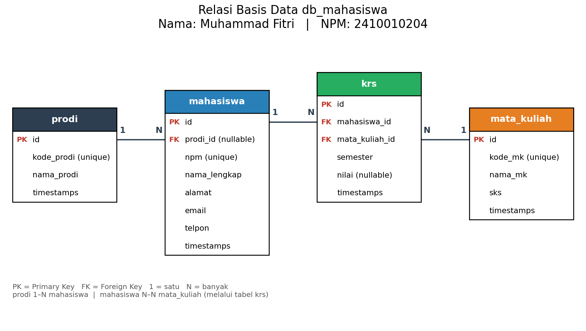

# Aplikasi Data Mahasiswa (Laravel)

| | |
|---|---|
| **Nama** | Muhammad Fitri |
| **NPM**  | 2410010204 |

Aplikasi pendataan mahasiswa menggunakan Laravel 8, MySQL, dan template AdminLTE 3 (dimuat lewat CDN, butuh koneksi internet).

## Gambar Relasi Basis Data



URL gambar: https://github.com/USERNAME/NAMA-REPO/blob/main/gambar_relasi.png

Tabel: `prodi` (1–N) `mahasiswa`, dan `mahasiswa` (N–N) `mata_kuliah` melalui tabel `krs`.

## Cara Menjalankan

```bash
composer install
cp .env.example .env        # lalu atur DB_DATABASE=db_mahasiswa, DB_USERNAME, DB_PASSWORD
php artisan key:generate
php artisan migrate --seed
php artisan serve
```

Buka `http://127.0.0.1:8000/mahasiswa`.

## Fitur

- CRUD **Mahasiswa**, **Prodi**, **Mata Kuliah**, dan **KRS** (tambah, ubah, hapus) dengan validasi dan pesan notifikasi
- Pencarian, pengurutan, dan pagination pada semua tabel (DataTables)
- Dropdown prodi pada form mahasiswa; KRS menghubungkan mahasiswa dan mata kuliah (relasi N–N)
- Dashboard berisi ringkasan jumlah data dan grafik (Chart.js): mahasiswa per prodi, distribusi nilai KRS, dan peminat per mata kuliah

Menjalankan tes otomatis (butuh database kosong terpisah, mis. `db_mahasiswa_test`):

```bash
DB_DATABASE=db_mahasiswa_test php vendor/bin/phpunit
```

## Database

File SQL siap impor: `database/db_mahasiswa.sql` (buat database kosong `db_mahasiswa` di phpMyAdmin, lalu Import).
Tabel sudah mengikuti migration, jadi tidak perlu `php artisan migrate` lagi setelah impor.

## Mengedit gambar relasi

Buka `gambar_relasi.drawio` di https://app.diagrams.net (File > Open from > Device), ubah Nama dan NPM,
lalu File > Export as > PNG dan simpan sebagai `gambar_relasi.png` (timpa file lama).
